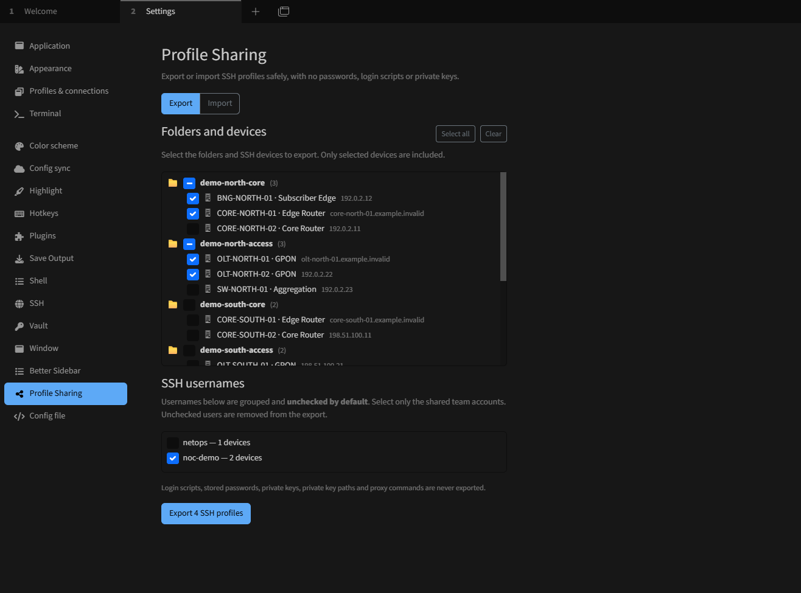
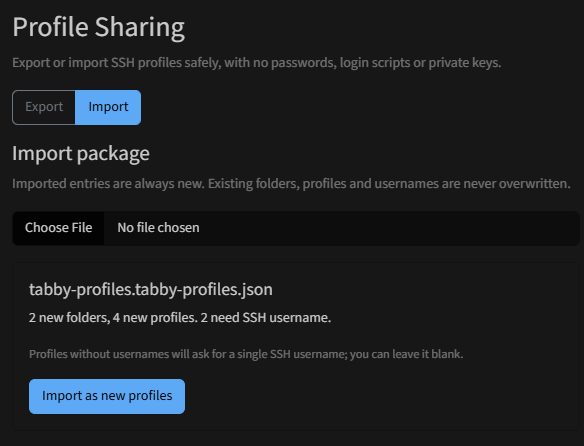
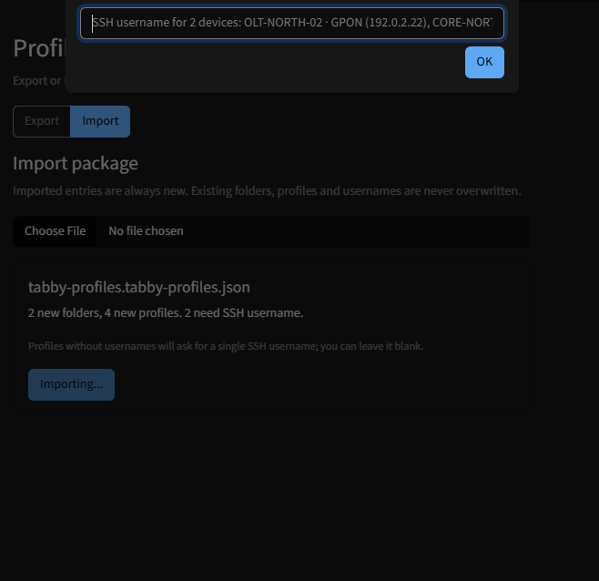
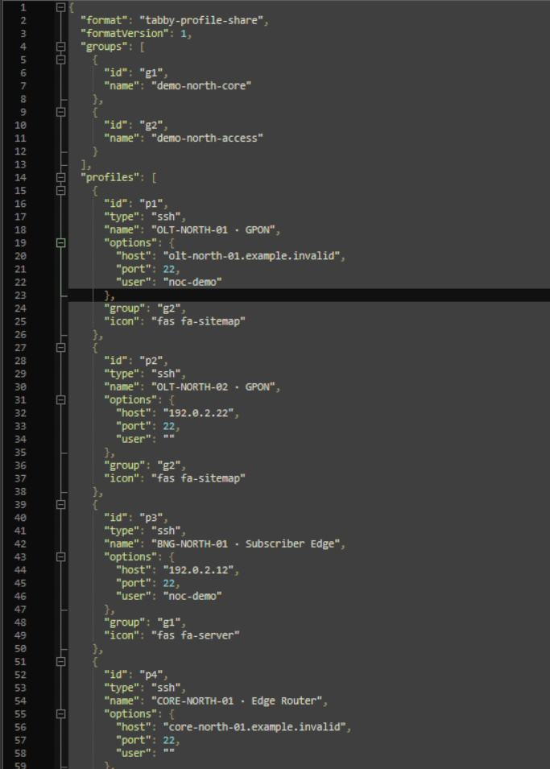

# Tabby Profile Share

**Share SSH profiles and their folder hierarchy safely with your team.**

[](https://github.com/gugahartmann/Tabby_Profile_Share/actions/workflows/test.yml)
[](LICENSE)
[](https://www.npmjs.com/package/tabby-profile-share)
[](https://www.npmjs.com/package/tabby-profile-share)

[Português (Brasil)](README.pt-BR.md)

Tabby Profile Share is an **independent, community-maintained plugin** for [Tabby by Eugeny](https://github.com/Eugeny/tabby). It does **not** modify Tabby, require the Tabby Performance fork, or have any affiliation with or endorsement from the Tabby maintainers.

**Available on npm:** [tabby-profile-share](https://www.npmjs.com/package/tabby-profile-share) · [GitHub releases](https://github.com/gugahartmann/Tabby_Profile_Share/releases) · [Report an issue](https://github.com/gugahartmann/Tabby_Profile_Share/issues/new/choose).

Tested with the official Tabby **1.0.235** plugin manager on Windows for installation; broader host versions and end-to-end import flows require continued community testing.

## Features

- Choose **folders, subfolders or individual SSH profiles** using a tree with checkboxes.
- Review distinct SSH usernames from the selected profiles; **all usernames are unchecked by default**. You explicitly choose which shared usernames to include.
- Export a portable, versioned `.tabby-profiles.json` file, preserving group hierarchy, host, SSH port and allowlisted connection settings.
- Exclude **passwords, login scripts, key material and key paths, and proxy commands**. No Vault access or remote sync.
- Import into **new groups and new profiles**, generating new IDs and preserving pre-existing profiles.
- Prompt for an SSH username when imported profiles have no username; display up to four example devices; retain explicitly shared usernames.
- Handle bundled jump-host relationships when both referenced profiles are in the export.

### What is intentionally not shared?

The file contains **no stored credentials**, private key paths or login scripts. Some advanced SSH options are deliberately not portable; these must be configured on the destination machine.

**Important:** Exported profiles still include hostnames, device labels, private IP addresses, and any usernames you deliberately selected. These are potentially sensitive network inventory. Treat the exported file as confidential, and inspect it before sharing it outside your organization.

## Installation compatibility

Versions 0.1.3+ remove runtime Angular/Tabby peer requirements to prevent npm `ERESOLVE` when legacy plugins (e.g., `tabby-save-output@3.1.0` with Angular 4) are present. Tabby itself supplies Angular and the Tabby APIs when loading plugins. This change does not remove required development dependencies from the project, and does not fix security issues in legacy plugins.

## Install

Open **Tabby → Settings → Plugins → Available**, search for **profile-share**, select `tabby-profile-share`, click **Get**, and restart Tabby when prompted. The plugin is distributed through [npm](https://www.npmjs.com/package/tabby-profile-share) and does **not** require cloning this repository. The Tabby search ranking may place new plugins near the bottom of results. Once installed, open **Settings → Profile Sharing**.

If you prefer a compiled, standalone package, check [GitHub Releases](https://github.com/gugahartmann/Tabby_Profile_Share/releases). The manual Windows option remains available below.

### Alternative: manual install on Windows

1. Download the **compiled plugin ZIP** from [Releases](https://github.com/gugahartmann/Tabby_Profile_Share/releases) or [Actions](https://github.com/gugahartmann/Tabby_Profile_Share/actions/workflows/test.yml).
2. The Actions artifact contains another ZIP with a top-level directory called `tabby-profile-share`. Extract that directory.
3. Close Tabby fully, including the tray icon, and copy the folder to:
   `%APPDATA%\tabby\plugins\node_modules\tabby-profile-share\`
4. Verify that both files exist inside that directory: `package.json` and `dist/index.js`.
5. Restart Tabby and open **Settings → Profile Sharing**.

Do not install the directory one level too high, or nest `tabby-profile-share` twice.

## Screenshots

These screenshots were taken from **Tabby using [synthetic demo SSH profiles](examples/demo-profiles.yaml)**. No real infrastructure, passwords or private keys appear in the examples.

### 1. Select folders, devices and shared usernames

Choose only the folders and devices to export. Username sharing is **opt-in**: accounts are unchecked by default, and in this example only `noc-demo` is selected.



### 2. Review the import before creating profiles

Import a `.tabby-profiles.json` package and review the number of new folders, new SSH profiles and missing usernames. Imported entries are created as new items; existing entries are not overwritten.



### 3. Supply missing SSH usernames

When imported profiles lack usernames, Tabby Profile Share asks for a shared SSH username and shows example devices. The field can be left empty.



### 4. Inspect the portable JSON export

The export contains versioned `groups` and `profiles` data, with sanitized connection options. It intentionally excludes passwords, private key files and login scripts.



## Use

**Export:** Select the folder tree, review the list of usernames (unchecked by default), explicitly enable only shared/team usernames, then click **Export**. Inspect the resulting JSON before distributing it.

**Import:** Make a backup of your Tabby configuration, open the **Import** tab, select the JSON, review its counts and confirm. The plugin adds new items; it does not replace existing entries. If any imported profiles lack usernames, it asks for one username to apply to those new profiles, or allows you to leave them blank.

See the [functional specification](docs/SPEC.md) for detailed behavior. Import has automated unit coverage, but full UI regression across Tabby releases remains on the roadmap.

## Development

Requirements: Node.js 22 and npm.

```bash
git clone https://github.com/gugahartmann/Tabby_Profile_Share.git
cd Tabby_Profile_Share
npm install --legacy-peer-deps
npm test
npm run build
npm pack --dry-run
```

The production entry point is `dist/index.js`. Angular and Tabby dependencies are external to the generated bundle, loaded by the host Tabby application.

The repository includes CI for unit tests, compilation, packaging, and compatibility with legacy Tabby plugins. Use a disposable Tabby configuration when testing imports. Project release procedures are documented in [docs/PUBLISHING.md](docs/PUBLISHING.md).

## Feedback and issue reports

Open an issue using one of the [three guided templates](https://github.com/gugahartmann/Tabby_Profile_Share/issues/new/choose): **Bug Report**, **Feature Request**, or **Custom / Question**. The forms follow the concise reporting style seen in the [Tabby Better Sidebar community](https://github.com/TooMuhtsh/tabby-better-sidebar/issues), with extra checks to protect SSH infrastructure data.

Please **never attach real SSH exports, internal hosts/IPs, login scripts, keys, passwords or unredacted logs**. Use synthetic samples. For security vulnerabilities, follow [SECURITY.md](SECURITY.md) rather than opening a public issue.

## Contributing and security

- [Contributing guide](CONTRIBUTING.md)
- [Security policy](SECURITY.md)
- [Changelog](CHANGELOG.md)
- [Release/publishing guide](docs/PUBLISHING.md)

Avoid committing real SSH exports, company network inventories or credentials in issues, pull requests, tests or screenshots. Report potential vulnerabilities privately using the instructions in `SECURITY.md`.

## License

[MIT](LICENSE) © 2026 gugahartmann and contributors.

Tabby is a separate project, developed and licensed independently by its authors. Tabby Profile Share is a community plugin, **not an official Tabby product**.
